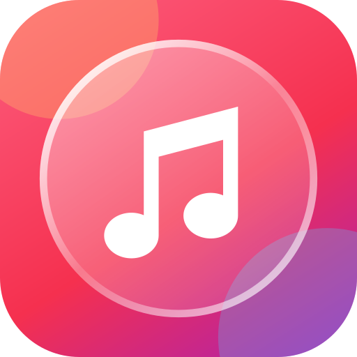
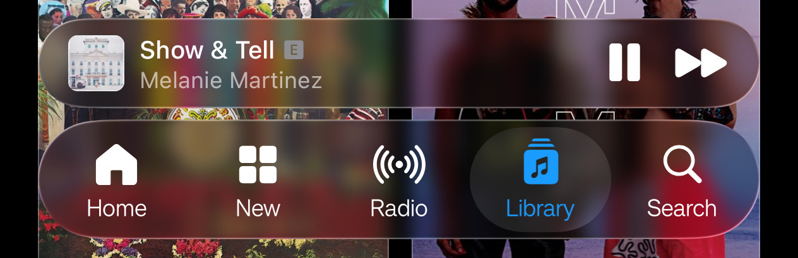
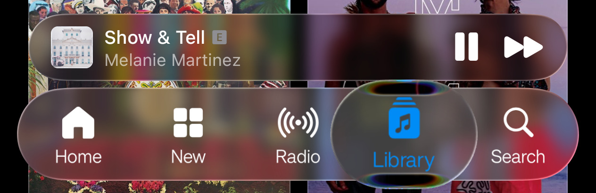

<div align="center">



# AM Liquid Glass

iOS 26 liquid glass for Apple Music on Android. An LSPosed / Xposed module.

<br>
<sub>Resting</sub>

<br>
<sub>Pressed: the dock grows and the selection turns into a lens</sub>

</div>

## What changes

- **Tab bar.** A floating glass capsule with blur and edge refraction. Press and drag a tab and the selection turns into a lens.
- **Mini player.** The same glass. Text and buttons switch between black and white depending on what's under them.
- **Header buttons and the ⋯ menu.** Glass instead of the stock blur.
- **Settings switches.** iOS-style green track with a pill thumb that turns to glass while pressed.

## Install

1. Download `am-glass-*.apk` from [Releases](../../releases) and install it.
2. In LSPosed, enable **AM Liquid Glass** with the scope set to **Apple Music**.
3. Force-stop Apple Music and open it again.

The APK is signed with a debug key, so you may need to uninstall the old one before updating.

| | |
| --- | --- |
| Apple Music | **7.0.0-beta** (versionCode 1611) only |
| Android | 13+ |
| Framework | LSPosed, Vector or another Xposed API 82 framework |
| Root | Magisk, KernelSU or APatch |

> [!NOTE]
> Apple Music is obfuscated, and the module looks for classes from this exact build. Other versions most likely won't get the glass. Tested on one phone (Realme, Android 16), so treat it as experimental.

<details>
<summary>How it works</summary>

- Apple Music draws its floating bars with Dimezis **BlurView**: a `BlurTarget` records the page into a `RenderNode`, and each `BlurView` blurs it. The module swaps the blur for a no-op and puts its own `ComposeView` inside, sampling the same `RenderNode` as a backdrop.
- The stock `BottomNavigationView` stays invisible and still provides the tabs, selection and clicks. Touches are forwarded to the glass dock.
- The module brings its own Compose runtime with a private lifecycle, because Apple Music's AndroidX is a separate obfuscated copy. Module resources use package id `0x6e`, so they never collide with the app's `0x7f`.
- The ⋯ menu is blurred by Haze inside the app's own Compose. The module hooks Haze's effect node and draws glass with platform `RenderEffect`s and the library's lens shader.

Source: [`app/src/main/java/dev/dimka/amglass`](app/src/main/java/dev/dimka/amglass).

</details>

<details>
<summary>Build</summary>

Needs JDK 21.

```sh
./gradlew :app:assembleRelease
```

The APK lands in `app/build/outputs/apk/release/`.

</details>

## Credits

Glass by [Kyant0/AndroidLiquidGlass](https://github.com/Kyant0/AndroidLiquidGlass): the `backdrop` library, plus the `LiquidBottomTabs` demo and its helpers, copied into [`catalog/`](app/src/main/java/dev/dimka/amglass/catalog) under Apache-2.0.

Not affiliated with Apple. Apple Music is a trademark of Apple Inc.

## License

[Apache-2.0](LICENSE)
